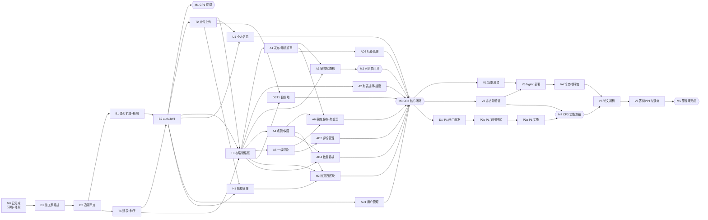

# P0 实施依赖图（DAG）· 从工程骨架到里程碑完成

| 项 | 值 |
| --- | --- |
| 版本 / 日期 | v1.0 / 2026-10-30 |
| 输入事实源 | [docs/FSR.md](../../docs/FSR.md) §6 检查点与 §10 前提、[docs/SRS.md](../../docs/SRS.md) §2–§3 P0 需求条目、[docs/hld.md](../../docs/hld.md) §2.2 模块追溯矩阵 / §3.2 建表剪裁 / §4.2 权限三档、[docs/gdd.md](../../docs/gdd.md) FR 四件套、[完善方案](../../旅游攻略分享网站毕业设计完善方案.md) §十 排期 |
| 粒度契约 | `.dsh/skills/ask-matt` 主流程：`wayfinder`（已收官）→ **`grill-with-docs`（每个待决节点先拷问定案，留 ADR / GLOSSARY）→ `to-spec`（把定案压成可施工的规格）→ `to-tickets`（拆 tracer bullet 垂直切片，声明 blockedBy 边）**；切片本身 = 一竖刀贯穿 表 / 后端 / 前端 / 测试，单会话可完成、可独立演示 |
| 图 | [p0-implementation-dag.drawio](p0-implementation-dag.drawio)（drawio 原生，可直接编辑）；[p0-implementation-dag.svg](p0-implementation-dag.svg) 为同一份布局的只读预览；第 3 节为同源 Mermaid 文本版 |
| 规模 | 36 个节点（26 张施工/验收票 + 4 张决策票 + 6 个里程碑）· 60 条阻塞边 |

## 1. 口径：什么算一个节点

本图节点 = **一张 tracer bullet 施工票** 或 **一个检查点里程碑**，两者不混同：

- **施工票（T）**：一竖刀，交付可演示的端到端行为；判据取自 SRS 验收判据 / GDD 规则，不自己发明。
- **决策票（D）**：wayfinder 式「先定案再施工」。询问粒度用 `grill-with-docs`（拷问 + 留痕 ADR/GLOSSARY），定案后用 `to-spec` 收敛成规格，再用 `to-tickets` 拆边。**不可跳过**：SRS 已确认，但「施工票怎么切、切多细、谁堵谁」本身仍是未决事项。
- **里程碑（M）**：只做验收，不产出代码；FSR §6 的 CP1 / CP2 / CP3 是硬闸门。
- 实现票收口一律 `/code-review`（Standards + Spec 双轴）；单票内部按 `/tdd` 红绿推进。

## 2. 已完成基线（2026-10-30 实测）

| 已完成 | 证据 |
| --- | --- |
| 文档链定案 | FSR / SRS / GDD / HLD 全部「已确认」；GLOSSARY 与 ADR-0001 就位 |
| wayfinder 地图收官 | `.scratch/hld-wayfinder/map.md`：7 张决策票全部关闭（审计 / 批复 / Node 工具链 / 两组留白接口 / 方案回写 / 骨架冒烟） |
| 环境闸门 | FSR §10 五项全勾：JDK 17.0.20.1、MySQL 8.0.46（3307 / utf8mb4）、mvnw 3.8.8、Node 24.21、Redis 3.2.100 |
| 工程骨架冒烟 | `backend`（Spring Boot 2.7.18 单模块 + `/api/ping`）、`frontend`（Vite+Vue3+TS+pnpm + `/api` 代理）三条验收实测通过 |

**即：M0 已经达成，本图的起点在 M0 右侧。**

**已落回主线的模块（2026-10-29）：auth-account** —— 一次性交付 B1 / T1 / B2 / T2 / U1 五个节点的竖直切片（user 单表 + admin 种子、注册登录与 jjwt 三档拦截器、单图上传与静态回显、个人信息与改密）。单独 commit `9cf2a19` 合入 `main`，实测后端 33 tests / 前端 5 tests / 前端 build 全绿；该模块的 spec 与票已删，代码与测试是它唯一的事实源。业务表：1 张（user）。

## 3. 依赖图

- 视觉版：[p0-implementation-dag.drawio](p0-implementation-dag.drawio)（箭头 A → B 读作「A 先完成，B 才能开工」）

> **重新生成图**：`node build-dag.cjs p0-implementation-dag.drawio p0-implementation-dag.svg`（需 `@dagrejs/dagre`）。脚本按节点表与边表算布局，同一次运行写出的 `.drawio` 与 `.svg` 是同一份版式。注意：**布局坐标受 dagre 版本影响**，换版本重跑会整体挪位（节点与边内容不变），因此已入库的这两份是当时的成图，小改请直接在 drawio 里拖；只有节点表/边表大改时才重跑并一并替换两张图。
- 文本版（同源）：

## 4. 节点表

> 「技能」列为该节点**主调用**；实现票一律默认 `/tdd` 打底、收口 `/code-review`，不再逐行重复。

### 4.1 决策票（先定案）

| ID | 节点 / 产出 | 依赖 | 技能 | 完成判据 |
| --- | --- | --- | --- | --- |
| D1 | 施工票编排：把本图 26 张施工/验收票落成 `.scratch/p0-impl/issues/` 逐票文件，边写进 blockedBy；粒度按 tracer bullet 复核 | M0 | `to-tickets` | 每票一文件、编号按依赖序、blockedBy 完整；用户过 granularity / edges 三问 |
| D2 | 追溯审定：SRS 条目 × GDD 四件套 × HLD 模块矩阵 × 施工票逐条对齐，防漏项与超范围；产出「无票覆盖的需求 = 0」结论 | D1 | `grill-with-docs`（内含 `grilling` + `domain-modeling`）→ `to-spec` | HLD §2.2 每行四列齐全；SRS §2–§3 每条 FR 至少一票覆盖；遗留分歧写成 ADR |

### 4.2 基础设施票

| ID | 节点 / 产出 | 依赖 | 技能 | 完成判据 |
| --- | --- | --- | --- | --- |
| B1 | 后端骨架扩域与横切底座：包结构按 HLD §2.2 落位；`Result` 统一响应、全局异常、`JwtInterceptor` 骨架（三档权限表）、MyBatis-Plus 分页/逻辑删除/自动填充、jsoup、Knife4j、`travel_share` 连接串（3307） | D2 | `implement` | 任一 `/api/**` 返回 `{code,message,data}`；错误码场景可复现；Knife4j 可打开 |
| T1 | 建表迁移与种子数据：P0 九张表 + `article.content_text` 增量 + 唯一索引（`user.username`、`like/collect(user_id,article_id)`）+ 预置 admin；GDD §6.1 种子规模 | D2 | `implement` | 表结构与 HLD §3.2 逐列一致；种子可支撑列表/详情演示；`SHOW CREATE TABLE` 留证 |
| B2 | 注册 / 登录 / JWT：BCrypt、2h token、ThreadLocal、路径级角色判断；前端 Pinia + Axios 拦截器 + 路由守卫 + 401 跳转 | B1, T1 | `implement` + `code-review` | **CP1 判据**：登录 → 携带 Token 请求 → 后端解析全链路通；过期 401 前端清态 |
| T2 | 文件上传模块 `/api/file`：本地磁盘、类型/大小校验（≤5MB，jpg/png/webp）、静态资源映射 | B2 | `implement` | 上传后回显可访问；非法类型/超限被拒并给业务错误 |

### 4.3 前台功能票（P0 交付主线）

| ID | 节点 / 产出 | 依赖 | 技能 | 完成判据 |
| --- | --- | --- | --- | --- |
| T3 | 攻略读路径最小闭环：article/article_tag 落地、`/api/article` 列表 + 详情、仅 approved 可见、浏览量 +1 | T1, B2, T2 | `implement` | 用种子数据即可浏览列表与详情页；非 approved 一律 404/空 |
| A1 | 攻略发布与编辑重审：富文本、封面必传、标签 1–3、天数/花费、存草稿与提交审核、编辑即撤回、pending 锁定 | T3 | `implement` | FR-ART-01 / FR-ART-05 判据逐条过；边 1/4/5/8 生效 |
| A2 | 攻略列表排序与搜索筛选：最新 / 最热（like+collect）、关键词（标题+正文副本）、目的地 / 标签 / 花费区间、空态、分页基线 | T3 | `implement` | FR-ART-02 / FR-ART-03 判据；组合筛选同时满足全部条件 |
| A3 | 攻略审核状态机：待审列表、通过 / 驳回（理由必填）、下架 / 恢复、乐观锁守卫（affected=0 → 业务错误） | T3, A1 | `implement` + `code-review` | SRS §1.3 八条边全集且仅这些边；FR-AUDIT-01 判据 |
| A4 | 点赞与收藏：唯一索引防重、计数同步、取消、事务边界 | T3 | `implement` | FR-ACT-01 / FR-ACT-02 判据；重复点赞被拒、取消后可再赞 |
| A5 | 一级评论与自删：发表、列表、仅 approved 可评、逻辑删除 | T3 | `implement` | FR-ACT-03 / FR-ACT-04 判据；自删后前台不显示、后台可查 |
| A6 | 我的发布 + 个人中心聚合页：五态徽标、驳回/下架理由可见、我的收藏/点赞/评论三列表 | A1, A4, A5 | `implement` | FR-USER-04 / FR-USER-05 判据；操作他人 id 返回权限错误 |
| U1 | 个人信息：昵称、头像（默认占位图）、简介、改密 | B2, T2 | `implement` | FR-USER-03 判据；旧密码失效、新密码可登 |
| DST1 | 目的地：后台 CRUD + 图片 + 前台聚合页（简介/图片 + 该目的地 approved 分页） | T2, T3, B2 | `implement` | FR-DST-01 / FR-ADMIN-DST-01 判据；新增后前台与发布表单同步出现 |
| H1 | 轮播图管理与首页渲染：增删改、排序、启用状态 | B2, T2 | `implement` | FR-ADMIN-CAR-01 判据；仅启用项显示、排序生效 |
| H2 | 首页四区块取数：热门攻略、最新发布、热门目的地入口、搜索框 | H1, T3, A4 | `implement` | FR-HOME-01 判据；四区块有数据且可点击 |

### 4.4 后台功能票

| ID | 节点 / 产出 | 依赖 | 技能 | 完成判据 |
| --- | --- | --- | --- | --- |
| AD1 | 用户管理：列表、禁用/启用、重置密码、角色分配（禁用后登录被拒；token 至多 2h 自然失效） | B2 | `implement` | FR-ADMIN-USER-01 判据 |
| AD2 | 评论管理：列表、删除违规评论、定位所属攻略 | A5 | `implement` | FR-ADMIN-COMMENT-01 判据 |
| AD3 | 标签管理：维护标签体系、逻辑删后表单与详情不再出现 | A1 | `implement` | FR-ADMIN-TAG-01 判据 |
| AD4 | 数据看板：用户总数、攻略总数（未删除全状态）、今日新增用户/攻略、热门 TOP10（仅前台可见）、ECharts | T3, A4, B2 | `implement` | FR-BOARD-01 判据；指标与库内抽测一致、刷新 < 2s |

### 4.5 里程碑与验收票

| ID | 节点 | 依赖 | 技能 | 完成判据 |
| --- | --- | --- | --- | --- |
| M1 | **CP1 联调闭环**（第 4 周末） | B2 | —（按 FSR §6 判据自检） | JWT 全链路跑通；不通过则延 1 周压第 5 周 |
| M2 | **前台可见性闭环**（先审后发的端到端演示） | A3 | — | 发布 → 待审 → 通过 → 前台可见 → 下架不可见，一条链路当场演示 |
| M3 | **CP2 核心闭环**（第 10 周末） | A2, A6, U1, AD1–AD4, DST1, H2, M2 | `code-review`（汇总审查） | P0 全部可演示；不通过则整体放弃 P1 |
| V1 | 功能测试用例执行与缺陷修复（对照 SRS §2–§3 验收判据逐条） | M3 | `diagnosing-bugs`（按需） | 用例表逐条有结论，阻断级缺陷清零 |
| V2 | 非功能验证：NFR-01/02 响应 < 2s、NFR-04 图片限制、NFR-05 安全四件套（BCrypt / JWT / 预编译 / jsoup）、NFR-03 分页基线 | M3 | `code-review` | 每项一条实测记录 |
| M4 | **CP3 功能冻结**（第 13 周末） | V2, P2a | — | 停止新增功能，转入论文 |
| V3 | Nginx 本地部署与演示环境（生产环境 `/api` 反代，断网可演示） | V1, V2 | `implement` | 断网状态下全流程可演示 |
| V4 | 论文材料包：系统测试用例表、界面截图、§10.3 图表清单复核 | V3 | `to-spec`（结构化收纳） | 图表清单逐项有对应文件 |
| V5 | 论文初稿（第三章取 SRS §1–§5、第四章取 HLD §1–§5、第五章取实现与测试） | V4, M4 | — | 七章式初稿成文 |
| V6 | 答辩 PPT 与演练 | V5 | — | 演示脚本 + 兜底截图 |
| M5 | **里程碑完成（毕设终点）** | V6 | — | 论文定稿 + 答辩通过 |

### 4.6 P1 分支（闸门之后才有资格开工）

| ID | 节点 | 依赖 | 技能 | 完成判据 |
| --- | --- | --- | --- | --- |
| P1 | P1 闸门裁决：五项（数据分析 / 猜你喜欢 / Redis / 楼中楼 / 行程结构化）进不进时间盒、砍切顺序 | M3 | `grill-with-docs` | 每项「做 / 砍」有结论并记录 |
| P2b | P1 文档回写：SRS §6 边界补齐为完整验收判据、GDD 补数值、方案 §十一 对齐 | P1 | `to-spec` | 选定项各有可测判据 |
| P2a | P1 实施（仅选定项，各自独立可砍） | P2b | `implement` / `implement-spec` | 按 SRS §6 砍切判据 |

## 5. 技能分工总览

| 阶段 | 技能 | 用在哪些节点 |
| --- | --- | --- |
| 编排 / 拆票 | `to-tickets` | D1（把本图落成逐票文件与 blockedBy 边） |
| 拷问定案 | `grill-with-docs`（= `grilling` + `domain-modeling`） | D2、P1；任何施工中冒出的设计分歧也回到这里定案 |
| 收敛规格 | `to-spec` | D2 产出施工规格、P2b 文档回写、V4 材料收纳 |
| 施工 | `implement`（单票，票间 `/clear`）或 `implement-spec`（P1 批量） | 全部 T/A/B/U/DST/H/AD 与 V3 票 |
| 红绿推进 | `tdd` | 所有 implement 票的内部节奏 |
| 双轴审查 | `code-review` | 每票收口；M3 汇总审查一次 |
| 排障 | `diagnosing-bugs` | V1 缺陷处理；联调卡壳时 |
| 复盘 | `retro` | M3 之后一次（环境侧改进，不产出代码） |
| 路由 | `ask-matt` | 每次不知道该走哪条技能时先问 |

## 6. 关键路径（决定总工期的链）

`M0 → D1 → D2 → T1 → T3 → A1 → A3 → M2 → M3 → V2 → M4 → V5 → V6 → M5`

宽口径（含 CP1）：`M0 → D1 → D2 → (B1‖T1) → B2 → M1 → T2 → T3 → A3 → M2 → M3`

可并行扇出：B2 之后 —— 上传 / 互动 / 后台五张 CRUD 互不阻塞；T3 之后 —— 发布、列表、审核、互动四条线可同时推进（不同 agent 会话按票认领）。

## 7. 边界

- **本图不含**：P2 全部（支付预订 / 小程序 / ES / 关注流 / 举报 / 系统设置）、开题报告文书、论文正文写作工艺（只留 V4–V6 三个节点）。
- **范围变更唯一入口**：先改 FSR §7，再动本图。
- 本图节点一旦在 `to-tickets` 落地成票文件，**进度以 `.scratch/p0-impl/issues/` 各票 Status 为准**，本文件不记进度快照。
