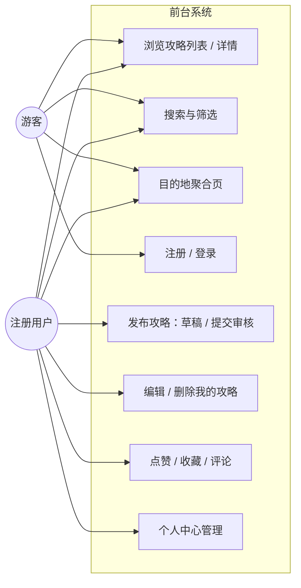
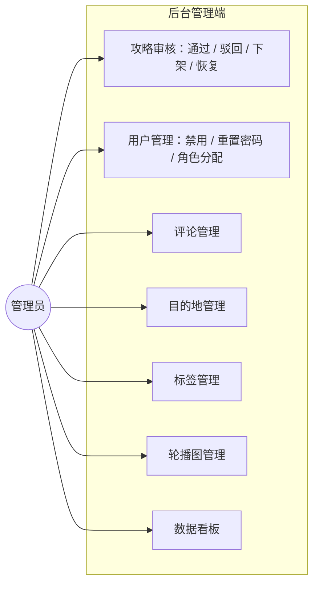
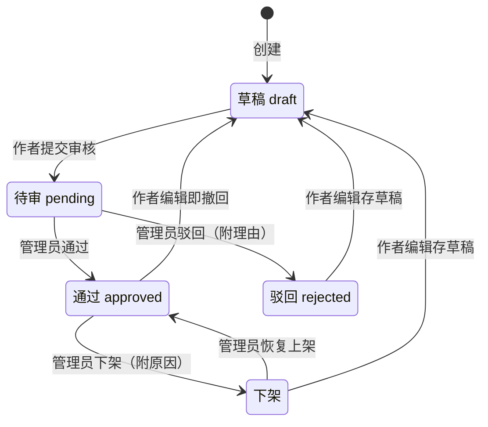
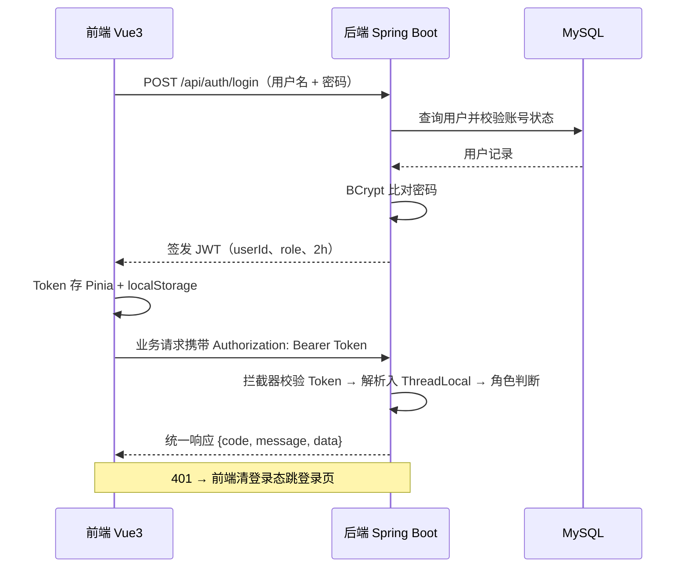
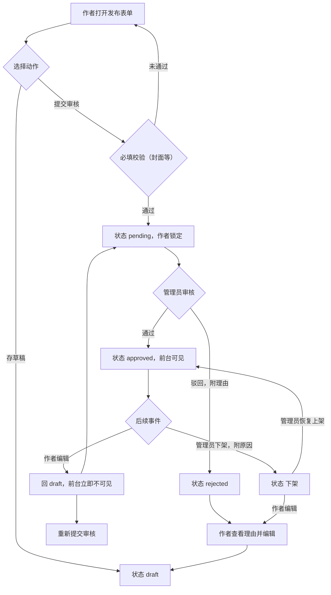

# 基于 Spring Boot 与 Vue3 的旅游攻略分享网站——软件需求规格说明书（SRS）

| 项 | 值 |
| --- | --- |
| 版本 / 日期 | v1.1 / 2026-10-30（v1.0：2026-10-29） |
| 状态 | **已确认**（2026-10-29 用户批复；同日经两轮功能设计拷问（27 项定案）收敛确认，细节规则落 [gdd.md](gdd.md)，术语落 [GLOSSARY.md](../GLOSSARY.md)） |
| 修订记录 | v1.1（2026-10-30）**措辞修订、不改语义**：§1.3 补充语义 2「普通用户」→「注册用户」（对齐 GLOSSARY 术语，其 Avoid 列禁用前者）。来源：`.scratch/hld-wayfinder/issues/07-完善方案-v1-1-回写执行.md` |
| 事实源 | [旅游攻略分享网站毕业设计完善方案.md](../旅游攻略分享网站毕业设计完善方案.md)（下称「方案文档」）、[FSR.md](FSR.md)（范围与可行性）、[DEV-ENVIRONMENT.md](DEV-ENVIRONMENT.md)（环境现状）、[gdd.md](gdd.md)（数值/规则/边界细节） |
| 冲突规则 | **功能需求与验收判据以本文为准**；范围分层（P0/P1/P2）以 FSR §7 为准；架构 / 库表 / 接口设计以方案文档 §六–§八为准；环境现状以 DEV-ENVIRONMENT.md 为准 |

> 本文是需求的单一事实源：只定「做什么，以及做到什么程度算完成」。技术选型、库表、接口细节一律回源方案文档；可行性判定回源 FSR。论文第三章「系统分析」可直接取 §1–§5 复用。

## 1. 总体描述

### 1.1 系统定位

集「攻略发布、浏览检索、互动分享、内容审核」于一体的 UGC 旅游攻略分享社区；前台（游客 / 注册用户）+ 后台（管理员）共用一套 REST API，JWT 区分权限。差异化定位：聚焦 UGC 攻略分享，不做门票 / 酒店交易（方案 §1.3）。

### 1.2 角色与权限边界

| 角色 | 权限要点 |
| --- | --- |
| 游客（未登录） | 浏览、搜索、查看目的地；不能发布和互动 |
| 注册用户 | 游客权限 + 发布攻略（含草稿）、点赞、收藏、评论、个人中心 |
| 管理员 | 内容审核、用户管理、基础数据维护、数据看板 |

前台 `/` 与后台 `/admin` 为两个独立路由区域，后台菜单按角色动态渲染（方案 §二）。

### 1.3 审核状态机（核心业务规则）

攻略生命周期五态（article.status）：`0 草稿 draft / 1 待审 pending / 2 通过 approved / 3 驳回 rejected / 4 下架`。

边的全集（除此之外不存在任何状态迁移）：

| # | 边 | 触发者 | 语义 |
| --- | --- | --- | --- |
| 1 | draft → pending | 作者 | 提交审核 |
| 2 | pending → approved | 管理员 | 审核通过，前台立即可见 |
| 3 | pending → rejected | 管理员 | 驳回，附驳回理由 |
| 4 | rejected → draft | 作者 | 编辑后存草稿，重新提交 |
| 5 | approved → draft | 作者 | **编辑即撤回**：前台立即不可见，重新走审核 |
| 6 | approved → 下架 | 管理员 | 下架，附下架原因 |
| 7 | 下架 → approved | 管理员 | 恢复上架（误杀找回） |
| 8 | 下架 → draft | 作者 | 编辑存草稿重发（与 rejected 同构） |

补充语义（与边集同等效力）：

1. **pending 锁定**：待审中作者不可编辑、不可撤回或删除，只能等审核结果。
2. **仅 approved 对前台可见**：游客与注册用户的一切读路径（列表 / 搜索 / 详情 / 聚合页 / 首页区块）只见 status=2。
3. **理由留痕读侧**：驳回理由与下架原因复用同一字段（reject_reason），对作者可见，作为重新编辑的输入。
4. 逻辑删除（deleted 字段）不是状态机的一态：作者可删除自己的 draft / rejected / approved / 下架 攻略（逻辑删，「我的发布」不再显示）；管理员的治理动作是下架而非删除。

### 1.4 需求条目约定

- 编号 `FR-<模块>-<NN>` / `NFR-<NN>`；每条带**可测验收判据**——实施完成的定义 = 判据逐条通过。
- §2–§3 全部为 P0（FSR §7 承诺范围，缺一即闭环不成立）；P1 条件增强见 §6；P2 排除清单以 FSR §7 为唯一事实源，本文不复制。
- 需求范围变更唯一入口：先修订 FSR §7，再动本文。

## 2. 前台功能需求

### 2.1 用户模块

| 编号 | 需求 | 验收判据 |
| --- | --- | --- |
| FR-USER-01 | 注册：用户名 + 密码；仅用户名唯一性校验，开放注册无邮箱 / 手机验证；不接受角色参数（默认 USER） | 重复用户名返回业务错误提示；成功注册即可登录；库内密码为 BCrypt 密文 |
| FR-USER-02 | 登录：BCrypt 校验 + 签发 JWT（payload 含 userId、role，有效期 2 小时，无 refresh token） | 正确凭证返回 token；错误密码统一提示；被禁用账号登录被拒并提示；token 过期后请求返回 401，前端清登录态并跳登录页 |
| FR-USER-03 | 个人信息管理：修改昵称、头像、简介、密码 | 昵称修改后前台作者信息同步显示；改密码后旧密码登录失败、新密码成功；头像未上传时显示内置默认占位图 |
| FR-USER-04 | 我的发布：查看 / 编辑 / 删除自己的攻略，带五态徽标 | 每条显示 draft / pending / approved / rejected / 下架 徽标；驳回与下架条目可见理由；操作他人攻略 id 返回权限错误 |
| FR-USER-05 | 个人中心聚合页：我的收藏 / 点赞 / 评论记录 | 三个列表各自分页；列表项可跳转对应攻略详情 |

密码规则：仅长度 6–20 校验（不做复杂度强制，避免演示注册受阻）。

### 2.2 攻略模块

| 编号 | 需求 | 验收判据 |
| --- | --- | --- |
| FR-ART-01 | 发布攻略：富文本（WangEditor）+ 封面图 1 张必传 + 关联目的地 + 选择标签 + 行程天数与人均花费 | 表单双动作——「存草稿」存为 draft、「提交审核」进 pending；封面缺失时提交被拦截；正文支持多图上传 |
| FR-ART-02 | 攻略列表：分页，最新（create_time）/ 最热（like_count + collect_count）排序 | 默认每页 10 条、上限 50；两种排序的顺序可区分；仅 approved 可见 |
| FR-ART-03 | 搜索与筛选：关键词（标题 / 内容）+ 目的地 + 标签 + 花费区间 | 组合筛选结果同时满足全部条件；无结果显示空态 |
| FR-ART-04 | 攻略详情：图文正文、作者信息、发布时间、浏览量、互动入口 | 每次打开详情浏览量 +1（P0 不防刷）；未登录点互动入口跳登录页 |
| FR-ART-05 | 编辑重审：见 §1.3 边 4 / 5 / 8 | 编辑已通过攻略后，前台立即不可见；待审中的编辑请求被拒（pending 锁定） |

图片规则：单图 ≤ 5MB，格式 jpg / png / webp；本地磁盘存储不引 OSS（断网可演示，FSR §4.1）。

### 2.3 互动模块

| 编号 | 需求 | 验收判据 |
| --- | --- | --- |
| FR-ACT-01 | 攻略点赞 / 取消点赞 | 同一用户重复点赞被 user_id + article_id 唯一索引拒绝；取消后可再赞；like_count 同步增减 |
| FR-ACT-02 | 攻略收藏 / 取消收藏 | 防重同上；收藏后「我的收藏」列表出现该攻略 |
| FR-ACT-03 | 一级评论：发表与列表展示 | 发表后详情页刷新可见；仅可评论 approved 攻略 |
| FR-ACT-04 | 删除自己的评论（逻辑删除） | 自删后前台不再显示；后台评论管理仍可查（治理需要） |

**点赞对象 = 攻略，评论不做点赞**（2026-10-29 问询定案；FSR §7 偏离声明）。二级评论（楼中楼）为 P1，见 §6。

### 2.4 目的地与首页

| 编号 | 需求 | 验收判据 |
| --- | --- | --- |
| FR-DST-01 | 目的地聚合页：该目的地全部攻略 + 简介与图片 | 聚合页列表 = 该 destination_id 下 approved 的分页结果 |
| FR-HOME-01 | 首页：轮播图（后台配置）+ 热门攻略 + 最新发布 + 热门目的地入口 + 搜索框 | 轮播仅显示后台启用项；四个区块各有数据且可点击进入 |

## 3. 后台功能需求

| 编号 | 需求 | 验收判据 |
| --- | --- | --- |
| FR-BOARD-01 | 数据看板（基础版）：用户总数、攻略总数、今日新增、热门攻略 TOP10，ECharts 饼图 / 折线图 | 四项指标与库内数据一致（抽测核对）；看板刷新 < 2s |
| FR-AUDIT-01 | 攻略审核：待审列表、通过 / 驳回（附理由）、下架（附原因）、恢复上架 | 状态迁移与 §1.3 边集完全一致；驳回 / 下架理由必填；恢复上架后前台立即可见 |
| FR-ADMIN-USER-01 | 用户管理：列表查询、禁用 / 启用、重置密码、角色分配 | 禁用后登录被拒；已签发 token 至多 2 小时随过期失效（立即失效 = P1 Redis 黑名单，方案 §6.1）；初始数据预置一个 admin 账号，管理员仅经角色分配产生 |
| FR-ADMIN-COMMENT-01 | 评论管理：评论列表、删除违规评论 | 删除后前台立即不可见；列表可定位所属攻略 |
| FR-ADMIN-DST-01 | 目的地管理：增删改查、图片上传 | 新增目的地后，前台聚合页与发布表单的目的地选项同步出现 |
| FR-ADMIN-TAG-01 | 标签管理：维护攻略标签体系 | 新增标签后发布表单可选；删除（逻辑删）后表单选项与攻略详情展示中不再出现该标签 |
| FR-ADMIN-CAR-01 | 轮播图管理：增删改、排序、启用状态 | 排序与启用状态变更后，首页轮播同步生效 |

管理端接口统一校验 role = ADMIN（方案 §6.3）。看板 P0 = overview 基础版；方案 §十一的四维度数据分析为 P1（见 §6）。

## 4. 非功能需求

| 编号 | 维度 | 量化要求 |
| --- | --- | --- |
| NFR-01 | 性能 | 常规接口响应 < 2 秒；列表接口分页 |
| NFR-02 | 性能 | 看板聚合接口 < 2 秒（P0 依赖 create_time / status 索引；P1 加 Redis 缓存 10 分钟） |
| NFR-03 | 易用性 | 分页默认 pageSize = 10，上限 50 |
| NFR-04 | 资源 | 单图 ≤ 5MB，格式 jpg / png / webp |
| NFR-05 | 安全 | 密码 BCrypt 不可逆；接口 JWT 鉴权；MyBatis-Plus 预编译防注入；富文本 jsoup 白名单过滤 + 输出转义防 XSS |
| NFR-06 | 兼容性 | 现代浏览器（Chrome / Edge 最新版）；本地部署断网可演示 |
| NFR-07 | 可维护性 | 三层架构、统一响应结构、Knife4j 接口文档（实现手段回源方案 §五 / §6.1） |

不承诺并发指标：演示场景为单浏览器多角色切换（2026-10-29 问询定案）。

## 5. 核心用例与关键流程

### 5.1 用例图（2 张，Mermaid flowchart 形式模拟）

### 5.2 核心用例表（5 张）

**UC-01 注册 / 登录**（参与者：游客；前置：无）
- 主流程：① 填写用户名（唯一）+ 密码（6–20）提交注册，BCrypt 入库 → ② 用户名 + 密码登录 → ③ 校验密码与账号状态，签发 JWT（userId / role / 2h）→ ④ 后续请求 Axios 携带 `Bearer Token`，后端拦截器解析入 ThreadLocal（方案 §6.3）
- 备选流：a 用户名重复 → 业务错误提示；b 密码错误 → 统一提示；c 账号被禁用 → 拒绝登录；d token 过期 → 401 → 前端清登录态跳登录页

**UC-02 发布攻略**（参与者：注册用户；前置：已登录）
- 主流程：① 打开发布表单（富文本 / 封面必传 / 目的地 / 标签 / 天数 / 花费）→ ②「存草稿」存为 draft，或「提交审核」过必填校验进 pending → ③ 管理员审核（UC-03）→ ④ approved 后前台可见
- 备选流：a 封面缺失 → 提交被拦截；b 被驳回 → 「我的发布」查看理由 → 编辑存草稿 → 重新提交；c 编辑已通过攻略 → 立即回 draft、前台不可见；d 待审中 → 编辑 / 撤回被拒（pending 锁定）

**UC-03 内容审核**（参与者：管理员；前置：存在 pending 攻略）
- 主流程：① 打开待审列表 → ② 查看攻略内容 → ③ 通过（approved，前台立即可见）或驳回（填理由，rejected）
- 备选流：a 已发布攻略违规 → 下架（附原因）；b 误杀 → 恢复上架回 approved

**UC-04 游客浏览检索**（参与者：游客；前置：无）
- 主流程：① 首页（轮播 / 热门 / 最新 / 热门目的地 / 搜索框）→ ② 列表分页浏览（最新 / 最热排序）→ ③ 组合筛选（关键词 / 目的地 / 标签 / 花费区间）→ ④ 打开详情（浏览量 +1）→ ⑤ 目的地聚合页
- 备选流：a 点互动入口 → 跳登录页；b 筛选无结果 → 空态

**UC-05 互动**（参与者：注册用户；前置：已登录；对象：approved 攻略）
- 主流程：① 点赞 → 唯一索引防重 → like_count +1 → ② 收藏 → 防重 →「我的收藏」可见 → ③ 发表一级评论 → 详情页可见
- 备选流：a 重复点赞 → 拒绝；b 取消赞 / 藏 → 计数 −1；c 自删评论 → 前台不显示（逻辑删）；d 违规评论 → 后台删除

### 5.3 审核状态机图

（pending 为锁定态：无作者侧出边；逻辑删除独立于状态机，见 §1.3 补充语义 4。）

### 5.4 关键流程图（2 张）

JWT 登录认证全链路（答辩重点，方案 §6.3）：

攻略发布与审核流程：

## 6. P1 条件增强（简规格）

触发条件（五项共用）：**CP2 通过**（第 10 周末 P0 全部可演示）+ 第 11–12 周时间盒；CP2 不通过则全弃（FSR §6）。每项可独立砍，砍切动作记录在案。

| 项 | 功能边界 | 砍切判据 |
| --- | --- | --- |
| 数据分析模块（方案 §十一） | 四维度指标（内容 / 用户 / 互动 / 内容画像），`/api/admin/stats/*` 聚合 SQL + Redis 缓存 10 分钟 + ECharts 图表页，时间范围筛选 | 时间盒结束未完成全部维度 → 交付已完成维度，其余砍 |
| 标签推荐「猜你喜欢」 | 按用户最近浏览 / 收藏的攻略标签推荐同标签热门攻略；数据分析产出兜底 | 无法在时间盒内完成 → 砍，首页不出现该区块 |
| Redis 热点缓存 | 首页热门攻略缓存、浏览量先写 Redis 再定时落库；Token 黑名单（立即禁用生效） | Redis 不可用不阻塞主流程（降级直查库） |
| 二级评论（楼中楼） | comment.parent_id 挂二级回复，详情页楼中楼展示 | 一级评论闭环异常 → 砍 |
| 行程结构化（第 N 天） | 攻略正文按「第 N 天」分段模板组织 | 与富文本编辑器集成超时 → 砍 |

P1 项不进入 P0 验收判据；某项决定实施时，先按本表边界补齐该项的完整验收判据。

## 7. 范围与排除

P0 / P1 / P2 分层与 P2 排除清单（支付 / 门票酒店预订 / 小程序端 / Elasticsearch / 关注流 / 举报处理 / 系统设置）以 **FSR §7 为唯一事实源**。任何 P2 项进入排期前，必须先修订 FSR §7。

## 8. 实现约束（本文唯一定案项）

JWT 认证 = **自定义拦截器 + jjwt**：HandlerInterceptor 校验 Token → 解析用户入 ThreadLocal → 路径级角色判断（管理端校验 role = ADMIN）。不采用 Spring Security（2026-10-29 问询定案；答辩叙事见方案 §6.3）。其余实现细节在设计 / 实施阶段按方案文档 §六–§八执行。

## 9. 后续指令（agent 消费）

1. 当前状态「已确认」（v1.0）：可作为实施依据。
2. 实施 P0 时逐条对照 §2–§3 验收判据自检；数值、规则、边界细节以 [gdd.md](gdd.md) 为准（其冲突规则声明对本文为增补关系）；本文与方案文档功能表冲突处，以本文为准。
3. P1 开工前置条件：CP2 通过；每项按 §6 边界与砍切判据执行。
4. 需求变更唯一入口：先修订 FSR §7，再动本文、gdd.md 与排期。
