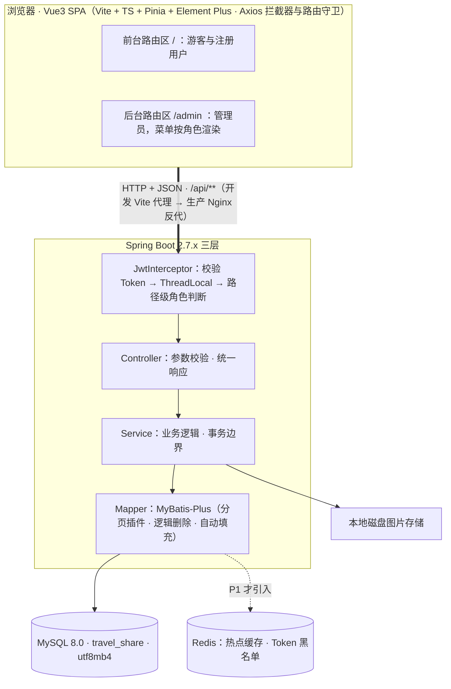
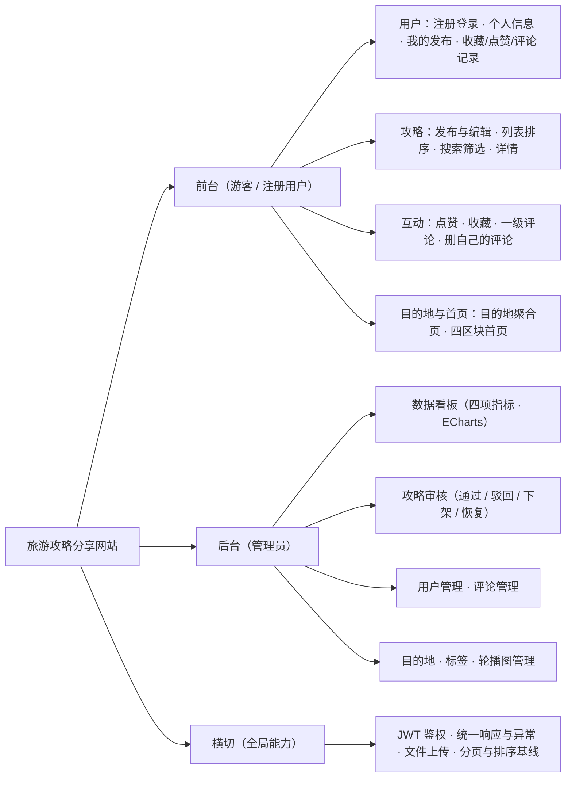
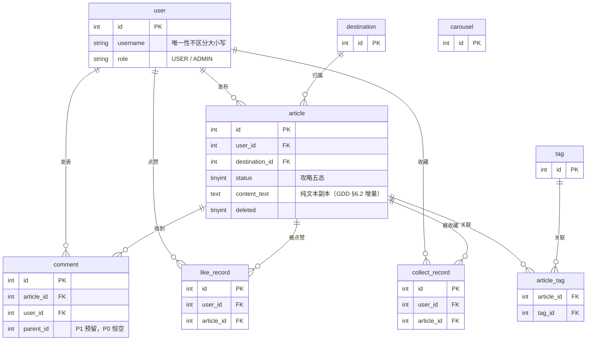

# 基于 Spring Boot 与 Vue3 的旅游攻略分享网站——概要设计说明书（HLD）

| 项 | 值 |
| --- | --- |
| 版本 / 日期 | v1.0 / 2026-10-29 |
| 状态 | **已确认**（2026-10-29 用户批复）；与 FSR / SRS / GDD 同级进入已确认文档链，本文定案项变更必须走 §6 指令 3 入口 |
| 事实源 | [SRS.md](SRS.md)（功能范围与验收基线）、[gdd.md](gdd.md)（数值/规则/边界细节）、[FSR.md](FSR.md)（范围分层 P0/P1/P2）、[旅游攻略分享网站毕业设计完善方案.md](../旅游攻略分享网站毕业设计完善方案.md)（架构/库表/接口明细回源，下称「方案文档」）、[DEV-ENVIRONMENT.md](DEV-ENVIRONMENT.md)（环境事实）、[GLOSSARY.md](../GLOSSARY.md)（术语） |
| 冲突规则 | **模块划分、包结构、库表 P0 剪裁、接口权限档与留白清单（本文定案项）以本文为准**；功能范围与验收判据以 SRS 为准；数值/规则/边界以 GDD 为准；范围分层以 FSR §7 为准；技术选型、字段明细、接口明细以方案文档 §六–§八为准；环境现状以 DEV-ENVIRONMENT.md 为准 |

> 本文是概要设计的单一事实源：只回答「系统划分为哪些模块、各模块的职责与边界、全局结构长什么样」。规则细节回源 GDD，功能范围回源 SRS，字段与接口明细回源方案文档。论文第四章「系统设计」可直接取 §1–§5 复用。

## 1. 设计总纲

### 1.1 全局设计决策索引

已定案决策的路由表——每行的唯一事实源在右列，本文不复制规则本体：

| # | 决策点 | 定案 | 事实源 |
| --- | --- | --- | --- |
| 1 | 认证 | 自定义拦截器 + jjwt（不采用 Spring Security）；Token 2h 无 refresh | [SRS §8](SRS.md) |
| 2 | 内容治理 | 先审后发：攻略五态状态机八条边 + pending 锁定 + 仅通过态前台可见 | [SRS §1.3](SRS.md) |
| 3 | 状态迁移并发 | 乐观锁守卫（条件更新，affected 0 行即业务错误） | [GDD §0.1](gdd.md) |
| 4 | 事务边界 | 跨表写收敛在 Service 单事务（组合提交、互动计数同步） | [GDD §0.1](gdd.md) |
| 5 | 搜索 | MySQL LIKE 标题 + 纯文本副本，不引 Elasticsearch | GDD FR-ART-03 / FSR §7 |
| 6 | 图片 | 本地磁盘存储，不引 OSS（断网可演示） | FSR §4.1 |
| 7 | 缓存 | Redis 仅 P1（P0 直查库；P1 不可用时降级直查） | FSR §7 / SRS §6 |
| 8 | 删除 | 逻辑删除旗标独立于状态机（攻略 / 评论 / 标签 / 目的地） | 方案 §7.3 / GDD §0.1 |
| 9 | 联调 | 开发 Vite 代理 `/api` → 8080；生产 Nginx 反代同前缀 | 方案 §6.4 |
| 10 | 数据库 | MySQL 8.0 · 库 `travel_share` · utf8mb4 · 端口 **3307**（非默认端口，连接串勿写 3306） | DEV-ENVIRONMENT.md |

### 1.2 总体架构

- 分层职责与每层要点 → 方案 §6.2；技术选型与配套组件清单 → 方案 §6.1
- JWT 认证全链路（答辩重点，含时序图）→ 方案 §6.3 + SRS §5.4
- 跨域与代理两种环境 → 方案 §6.4
- 运行环境、连接串、账号 → DEV-ENVIRONMENT.md（环境唯一事实源，本文不缓存）

## 2. 功能模块设计

### 2.1 功能结构图

### 2.2 后端模块清单与需求追溯【本文定案】

后端按模块分包，三层（controller / service / mapper）内按模块聚合；工程骨架未建时按此落地。前端模块划分见 §2.1 功能结构图与 §2.3 基线，本矩阵只列后端模块（表与前缀挂在后端）：

| 模块 | 职责 | 需求锚点 | 主要表 | 接口前缀 | 规则细节指针 |
| --- | --- | --- | --- | --- | --- |
| auth | 注册 / 登录 / 角色落地与来源路由回跳 | FR-USER-01/02 | user | /api/auth | GDD §1 · §0.3 |
| user | 个人信息 / 我的发布 / 个人中心聚合三列表 | FR-USER-03/04/05 | user · article · 三记录表 | /api/user | GDD §1 · §0.6 |
| article | 发布 / 编辑重审 / 列表 / 搜索 / 详情 | FR-ART-01–05 | article · article_tag · tag · destination | /api/article | GDD §2 · §0.1 |
| interact | 点赞 / 收藏 / 一级评论 | FR-ACT-01–04 | like_record · collect_record · comment · article 计数列 | /api/like · /api/collect · /api/comment | GDD §3 · §0.5 |
| destination | 目的地聚合页 / 首页四区块取数 | FR-DST-01 · FR-HOME-01 | destination · article · carousel | /api/destination · /api/home（只读，明细见方案 §8.4） | GDD §4 |
| file | 图片上传（封面 / 正文 / 头像 / 目的地 / 轮播） | FR-ART-01 等各上传入口 | —（本地磁盘） | /api/file | GDD §0.4 |
| admin | 看板 / 审核 / 用户 / 评论 / 目的地 / 标签 / 轮播 | FR-BOARD-01 · FR-AUDIT-01 · FR-ADMIN-*（5 张） | 全部业务表 | /api/admin | GDD §5 |
| common（横切） | JwtInterceptor · 全局异常处理 · 统一响应 · MyBatis-Plus 配置 · jsoup 过滤 · Knife4j 接口文档 | NFR-05 / NFR-07 · SRS §8 | — | — | GDD §0.2/§0.3 · 方案 §6.1/§6.3 |

### 2.3 前端工程基线（指针）

- 前台 `/` 与后台 `/admin` 两个独立路由区域、后台菜单按角色动态渲染 → 方案 §二
- Axios 请求/响应拦截器与 Pinia 登录态、401 清态跳登录页 → 方案 §6.3 + GDD §0.3
- 页面形态基线（「我的发布」卡片流、发布表单纵向单页 + 吸底双动作）→ GDD §6.3

## 3. 数据库设计（概要）

### 3.1 E-R 图（P0 实体）

E-R 图只画标识列、外键与三个特殊列；概念关系全集 → 方案 §7.1；字段明细 → 方案 §7.2（含 GDD §6.2 增量列）；设计原则（自动填充、计数冗余、索引、utf8mb4）→ 方案 §7.3。

### 3.2 表清单与 P0 剪裁【本文定案】

P0 建表 9 张：`user / destination / article / tag / article_tag / comment / like_record / collect_record / carousel`。report（举报）表不建（FSR §7 P2 排除）。

四个剪裁与预留（本文定案项，GDD 与方案文档未覆盖处）：

1. **comment.parent_id 建表即含，P0 恒空**：一级评论不写入该列；P1 二级评论免 ALTER 迁移。
2. **like_record / collect_record 不设逻辑删除旗标**：「取消」即删除关联行——`user_id + article_id` 唯一索引才能持续防重（取消后可再赞）。这两张表是全部业务表中仅有的两张行级删除表。
3. **article_tag 关联行随攻略保存整体重建**（删旧插新），行本身无逻辑删除语义；标签逻辑删后历史关联行留库不清理（GDD FR-ADMIN-TAG-01）。
4. **report 表的排除连带接口**：`/api/report/**` 不进入 §4.2 权限档表，实施期不为其留桩。

库名、连接串、端口 → DEV-ENVIRONMENT.md；种子数据范围 → GDD §6.1。

## 4. 接口设计（概要）

### 4.1 统一约定（指针）

- 响应结构 `{code, message, data}` 与分页参数（pageNum / pageSize → records / total / pages）→ 方案 §8.1
- HTTP 状态码场景（400 业务拒绝 / 401 未登录 / 403 无权限 / 404 / 500）与前端 Axios 分发 → GDD §0.2
- 分页基线（默认 10、上限 50）与最热公式排序 → GDD §0.5

### 4.2 模块前缀与权限三档【本文定案】

| 权限档 | 判定 | 覆盖前缀 |
| --- | --- | --- |
| 公开 | 游客可访问，无 Token 要求 | /api/auth/**（注册、登录）；/api/article 读路径；/api/destination/**、/api/home/**（只读取数） |
| 登录 | 有效 JWT（USER 或 ADMIN 均可） | /api/user/**；/api/article 写路径；/api/like · /api/collect · /api/comment；/api/file |
| ADMIN | role = ADMIN | /api/admin/**（SRS §3：管理端统一校验） |

代表性接口明细 → 方案 §8.2；三档判定与 SRS §1.2 角色边界一一对应。

### 4.3 设计留白【本文定案】

方案 §8.2 是**代表性**接口清单。以下两组接口的明细在实施期按 §4.1 约定补齐，属设计留白而非范围缺口（需求锚点在 SRS §2 均已闭环）：

1. **user 侧**：我的发布（五态徽标列表）/ 聚合三列表的取数接口；
2. **destination / home 只读取数**：目的地简介与图片、首页四区块（轮播 / 热门 / 最新 / 热门目的地）——已定案，明细见方案 §8.4（含顺手定案的 `GET /api/destination/list` 选项列表）。

补齐时前缀落在 §4.2 对应权限档内，接口明细回写方案文档 §八或本文修订版。

## 5. 论文复用指引

| 论文第四章小节 | 取材 | 配图 |
| --- | --- | --- |
| 总体架构设计 | 本文 §1 | §1.2 架构图 |
| 功能模块设计 | 本文 §2 | §2.1 功能结构图 |
| 数据库设计 | 本文 §3 + 方案 §7.2 字段表 | §3.1 E-R 图 |
| 接口设计 | 本文 §4 + 方案 §八 | — |
| 数据分析模块设计（P1 实施才写） | 方案 §十一 + SRS §6 | — |

图表清单对照（方案 §10.3 硬性配图）：系统架构图（本文 §1.2）、功能结构图（§2.1）、E-R 图（§3.1）、审核状态图（SRS §5.3）、用例图 2 张（SRS §5.1）、核心流程图（SRS §5.4）——开题与论文配图全部落位。

## 6. 后续指令（agent 消费）

1. **读序**：实施任一模块前，先在 §2.2 追溯矩阵定位模块与规则指针，再进 GDD 对应 FR 四件套；字段 / 接口明细回源方案 §七 / §八。
2. **开工判据**：§2.2 某行四列全部对上——需求锚点在 SRS 有编号、规则细节在 GDD 有四件套、表在 §3.2 清单内、前缀在 §4.2 权限档内——才可开工；任一列落空先补文档再写码。
3. **本文定案项**（§2.2 包结构 / §3.2 剪裁 / §4.2 权限档 / §4.3 留白）变更唯一入口：先修订本文，再动下游代码。数值规则变更走 GDD 入口，范围变更走 FSR §7 入口。
4. **状态**：已确认（2026-10-29 用户批复定稿）。本文定案项变更必须走指令 3 的入口。
